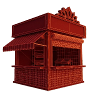
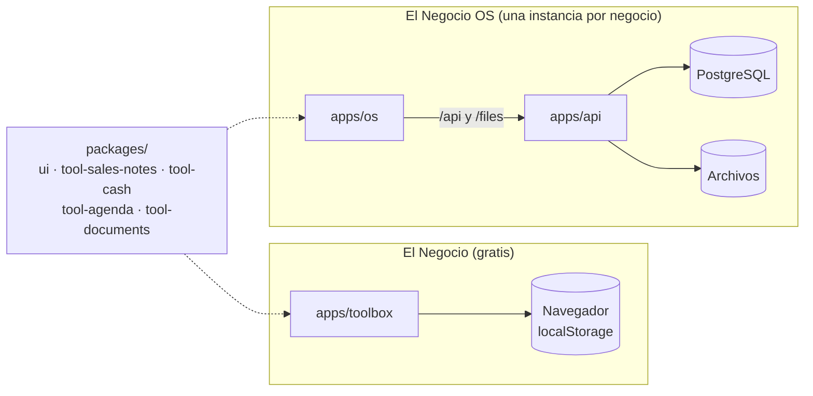

<div align="center">



# El Negocio

**Herramientas para negocios pequeños: gratis en el navegador y, para quien necesita más,
un sistema propio.**


[Productos](#productos) ·
[Arquitectura](#arquitectura) ·
[Inicio rápido](#inicio-rápido) ·
[Documentación](#documentación) ·
[Contribuir](#flujo-de-trabajo)

</div>

---

## Productos

| Producto | Carpeta | Qué es | Guía |
| --- | --- | --- | --- |
| **El Negocio** | `apps/toolbox` | Micro apps gratuitas y sin cuenta; los datos se quedan en el navegador | [README](apps/toolbox/README.md) |
| **El Negocio OS** | `apps/os` | Sistema de paga de un negocio: su página pública y su panel de administración | [README](apps/os/README.md) |
| **El Negocio API** | `apps/api` | Backend de El Negocio OS | [README](apps/api/README.md) |

**Mismas herramientas, distinta casa.** Las micro apps viven en `packages/` y las usan las
dos aplicaciones web; la marca, el color y los avisos son de cada una. El Negocio y
El Negocio OS no comparten datos, sesión ni servidor. Una instancia de El Negocio OS
muestra el nombre y el logo de **su** negocio y no enlaza al sitio gratuito.

## Arquitectura



**Una instancia = un negocio.** Cada cliente tiene su propio front, API y base de datos.
El API decide su negocio con `BUSINESS_SLUG`; no hay multi-tenant.

## Estructura del repositorio

```text
.
├── apps/
│   ├── api/                 API (NestJS + Postgres). Sesión con cookie JWT, archivos en disco
│   ├── os/                  Front de El Negocio OS: landing pública y panel
│   └── toolbox/             Herramientas gratuitas (Next.js, sin backend, PWA)
├── packages/
│   ├── ui/                  Tema y componentes compartidos
│   ├── tool-sales-notes/    Micro app de notas de venta
│   ├── tool-cash/           Micro app de entradas y salidas
│   ├── tool-agenda/         Micro app de agenda
│   └── tool-documents/      Micro app de contratos y pagarés
├── docs/                    Guías de despliegue y de las micro apps
├── docker-compose.yml       Stack de una instancia en producción
└── pnpm-workspace.yaml      Workspace: os, toolbox y packages
```

`os` y `toolbox` forman un workspace de pnpm con `packages/` (un lockfile en la raíz) y sus
imágenes se construyen desde la raíz. `api` es independiente: su propio lockfile y
Dockerfile, construido desde su carpeta.

## Inicio rápido

### Requisitos

| Herramienta | Versión | Para qué |
| --- | --- | --- |
| Git | | Clonar el repo |
| Node.js | 22 | Las apps web |
| pnpm | 10 (`npm install -g pnpm@10.19.0`) | Dependencias |
| Docker con Compose | Por ejemplo, Docker Desktop | Solo para `os` y el API |

Instala las dependencias en la raíz del repo:

```bash
pnpm install
```

### Elige qué correr

| Quiero trabajar en | Comando (desde la raíz) | Dirección | Antes necesitas |
| --- | --- | --- | --- |
| Toolbox | `pnpm --dir apps/toolbox dev -p 3001` | http://localhost:3001 | Nada más |
| OS | `pnpm --dir apps/os dev` | http://localhost:3000 | La base y el API: [guía de OS](apps/os/README.md#desarrollo-local) |

### Antes de integrar cambios

Un cambio en `packages/` afecta a las dos apps: compila ambas.

```bash
pnpm --dir packages/ui typecheck
pnpm --dir packages/tool-sales-notes typecheck
pnpm --dir packages/tool-cash typecheck
pnpm --dir packages/tool-agenda typecheck
pnpm --dir packages/tool-documents typecheck
pnpm --dir apps/os build
pnpm --dir apps/toolbox build
```

## Documentación

| Documento | Contenido |
| --- | --- |
| [Toolbox](apps/toolbox/README.md) | Desarrollo, PWA y reglas de identidad del sitio gratuito |
| [El Negocio OS](apps/os/README.md) | Instalación local paso a paso y problemas comunes |
| [API](apps/api/README.md) | Backend y documentación de los endpoints |
| [Micro apps compartidas](docs/PACKAGES-TOOLS.md) | Estándar visual, puertos y cómo agregar una herramienta |
| [Despliegue en Coolify](docs/DEPLOY-COOLIFY.md) | Instancias, datos, respaldos y producción |

## Despliegue

| Qué se despliega | Con qué |
| --- | --- |
| Una instancia de El Negocio OS | `docker-compose.yml` de la raíz (Postgres + API + front) |
| El sitio gratuito | `apps/toolbox/Dockerfile`, con la raíz como contexto |

> **Antes de pasar a producción**, revisa la sección *9. Pasar a producción* de la
> [guía de Coolify](docs/DEPLOY-COOLIFY.md): `IMAGE_OPTIMIZATION` cambia entre la máquina
> de pruebas y producción.

## Flujo de trabajo

| Rama | Uso |
| --- | --- |
| `main` | Producción |
| `dev` | Integración |
| `[nombre]-[AAMMDD]-ARM` | Un cambio, creada desde `dev`. Ej. `login-261124-ARM` |

1. Crea tu rama desde `dev`.
2. Comprueba el cambio en local.
3. Abre un *pull request* hacia `dev` y resuelve conflictos si los hay.
4. Verifica en `dev` y abre otro *pull request* de `dev` a `main`.

## Historial

Los repos originales (`arm-solutions-api` y `i-am-a-pos-frontend`) se importaron con todo
su historial de commits. Los commits anteriores conservan sus rutas antiguas (sin el
prefijo `apps/api/` ni `apps/os/`).

---

<div align="center">

Hecho por **Ing. Alexis Romero Mendoza**

</div>
